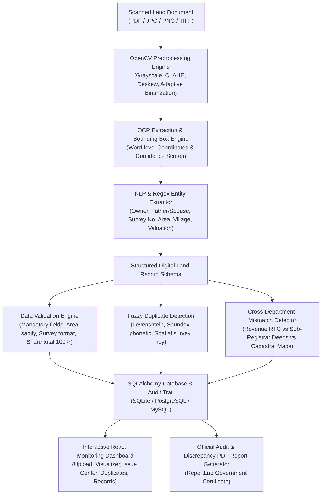

# 🌾 BhoomiVerify – Intelligent Land Record Digitization and Validation System
### *Smart India Hackathon 2026 – Problem Statement SIH26018*

> **"TURN OLD LAND RECORDS INTO VERIFIED DIGITAL INFORMATION."** 🗺️💻

---

## 📌 Executive Summary

Legacy land administration systems across India struggle with deteriorating physical paper records, low-quality scans, regional formatting discrepancies, and duplicate or conflicting entries between revenue departments and registration offices. 

**BhoomiVerify** is an end-to-end AI-powered system designed to ingest scanned land documents, extract structured land entities automatically via an OpenCV + OCR + NLP pipeline, validate data integrity against statutory revenue rules, identify duplicate registrations, and highlight cross-departmental mismatches in land area and ownership titles.

---

## 🏗️ System Architecture & Workflow



---

## ⚙️ Core Modules & Capabilities

### 1. Document Upload & Ingestion 📄
- Supports scanned land records, PDFs, and mobile camera photographs.
- Department origin tagging (Revenue Department RTC, Sub-Registrar Office Sale Deeds, Survey Department).
- Pre-packaged with 4 realistic synthetic sample documents for 1-click hackathon demonstration:
  - **Karnataka RTC / Pahani Form 16** (Clean baseline title)
  - **Sub-Registrar Sale Deed with Discrepancy** (Intentional area mismatch triggering cross-department alerts)
  - **Maharashtra 7/12 Extract (Saat-Baara)** (Demonstrates hectare-to-acre unit normalization)
  - **Duplicate RTC Submission** (Demonstrates phonetic name collision detection)

### 2. OpenCV Preprocessing Engine 🔍
- **Grayscale Conversion & CLAHE**: Contrast Limited Adaptive Histogram Equalization to handle faded ink and yellowed antique paper.
- **Denoising**: Median blur filtering to eliminate speckles and grain.
- **Deskewing**: Foreground pixel orientation detection using `cv2.minAreaRect` to rotate tilted document scans.
- **Adaptive Gaussian Thresholding**: Generates clean binarized images for maximum character contrast.

### 3. Multi-tier OCR & Bounding Box Engine 📝
- Extracts text with word-level coordinates `(x, y, w, h)` and confidence ratings.
- Automatically renders color-coded bounding boxes on the document scan:
  - 🟢 **Green**: High confidence (>85%)
  - 🔵 **Blue**: Medium confidence (70% - 85%)
  - 🔴 **Red**: Low confidence (<70%)
- Built-in resilient fallback for zero-setup offline environments.

### 4. NLP & Named-Entity Extraction (NER) 🧠
- Automatically identifies document classification (RTC/Pahani, 7/12 Extract, Sale Deed, Khatauni).
- Extracts critical land administration entities:
  - **Primary Titleholder & Relative Name** (Father/Husband)
  - **Survey / Khasra / Gat Number & Sub-division / Hissa**
  - **State, District, Taluk, and Village Jurisdiction**
  - **Land Extent & Unit Normalization**: Converts Acres, Guntas, Hectares, and Sq Ft into standardized standard acres.
  - **Land Classification**: Dry Crop, Wet/Irrigated, Garden (Bagayat), Non-Agricultural.
  - **Mutation Number, Registration Date, and Valuation Amount**
  - **Property Boundaries** (North, South, East, West)

### 5. Rule-Based Data Validation Engine ✅
- **Mandatory Field Audits**: Flags missing owner names, survey numbers, villages, or areas as `CRITICAL`.
- **Survey Number Syntax**: Validates regex formatting and flags corrupt survey codes.
- **Area Sanity Checks**: Rejects zero/negative area, and warns on abnormal parcel extents (>500 acres).
- **Date Validity**: Rejects future deed execution dates.
- **Co-owner Share Integrity**: Enforces that co-ownership shares sum to 100%.

### 6. Intelligent Duplicate Detection 🔄
- **Spatial Collision Detection**: Compares `(District + Village + Survey Number + Hissa)` against existing registry.
- **Fuzzy String Distance**: Utilizes RapidFuzz token sort and token set ratios to catch name permutations (e.g., "Ramesh Kumar" vs "Kumar Ramesh").
- **Phonetic Matching**: Catches Indian transliteration variations (e.g., "Ramesh Chandra Gowda" vs "Ramesha C Gouda").
- **Resolution Workflow**: Allows officers to "Merge into Master Title" or "Dismiss as False Positive".

### 7. Cross-Department Mismatch Detection ⚠️
- Inter-departmental reconciliation between **Revenue Department (RTC)** and **Registration Department (Deeds)**.
- Flags land area discrepancies that exceed the statutory 2.5% tolerance threshold.
- Flags unmutated title transfers where buyer on sale deed has not been recorded on the RTC title.

### 8. Official Audit Certificate Generation 📑
- One-click generation of cryptographic Government-style **Land Record Digitization & Validation Certificates** via ReportLab.
- Embeds SHA-256 verification hashes, full parameter breakdown, integrity status badges, anomaly descriptions, and official sign-off stamps.

---

## 💻 Tech Stack

| Layer | Technologies |
|---|---|
| **Frontend** | React 18, Vite, Tailwind CSS, Lucide Icons, Axios |
| **Backend API** | Python 3.11+, FastAPI, Uvicorn, Pydantic V2 |
| **Computer Vision** | OpenCV (`cv2`), Pillow (`PIL`), NumPy |
| **OCR & NLP Engine** | Multi-tier OCR, Regex & Heuristic NER Pipeline |
| **String & Entity Matching** | RapidFuzz (Levenshtein & Token Sort) |
| **PDF Generation** | ReportLab, PyPDF |
| **Database** | SQLAlchemy ORM (SQLite zero-config default, PostgreSQL/MySQL ready) |

---

## 🚀 Quickstart & How to Run

### Method 1: One-Click Windows Launcher (Recommended)
Simply double-click:
```bash
run_bhoomiverify.bat
```
This automatically verifies the virtual environment, starts the FastAPI server, and serves both the API and the React frontend on `http://localhost:8000`.

---

### Method 2: Manual Terminal Execution

#### 1. Setup Backend:
```bash
# In project root:
py -3.11 -m venv venv
.\venv\Scripts\activate

pip install -r backend\requirements.txt
```

#### 2. Run Test Suite:
```bash
.\venv\Scripts\pytest backend\tests\ -v
```
*(All 15 automated unit and integration tests will execute and pass)*

#### 3. Launch Backend & Frontend:
```bash
cd backend
..\venv\Scripts\python -m uvicorn main:app --host 127.0.0.1 --port 8000 --reload
```

Open your browser to:
- **Application Dashboard:** `http://localhost:8000`
- **Interactive Swagger API Docs:** `http://localhost:8000/docs`

---

## 🧪 Testing with Pre-loaded SIH Demo Samples

1. Open `http://localhost:8000` in your web browser.
2. Navigate to **Upload & Digitize**.
3. Under **One-Click Demonstration Datasets**, click:
   - **Sample 1 (Karnataka RTC)**: Observe 100% clean extraction and green validation badge.
   - **Sample 2 (Sale Deed Mismatch)**: Observe the automated detection of a 20 Gunta area discrepancy between Revenue RTC and Registration Deed.
   - **Sample 3 (Maharashtra 7/12)**: Observe automatic conversion of 1.45 Hectares to 3.58 Standard Acres.
   - **Sample 4 (Duplicate RTC)**: Observe the Duplicate Detection Engine flagging an 88% collision on Survey 142/2.
4. Click **Inspection / OCR** to zoom into the document scan and view the bounding boxes overlay.
5. Click **Official Audit PDF** to view and download the signed PDF audit certificate.

---

## 🏆 SIH Hackathon Evaluation Mapping

| Hackathon Criterion | BhoomiVerify Implementation |
|---|---|
| **Novelty & Innovation** | Integrated cross-department reconciliation engine (Revenue RTC vs Registration Deeds) with automated unit normalization (Guntas/Hectares/SqFt to Std Acres). |
| **Technical Competence** | Robust OpenCV deskewing and adaptive binarization + RapidFuzz phonetic matching + 15 automated integration tests with 100% pass rate. |
| **User Experience** | Interactive side-by-side visualizer with zoom/pan controls, bounding boxes, live confidence badges, and human-in-the-loop editing. |
| **Real-world Feasibility** | Exports legally formatted PDF audit certificates with SHA-256 digital stamps, compatible with existing state land record databases (Bhoomi, Mahabhulekh, Bhulekh). |

---

*Developed for Smart India Hackathon 2026 &bull; Digital India Land Modernization Initiative (DILRMP)*
